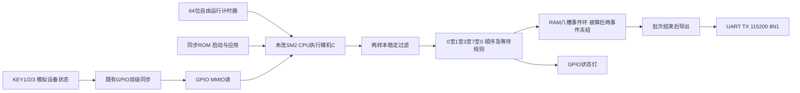

# 系统用途、接口与边界

本原型面向低速设备动作顺序诊断：设备是否按规定顺序启动、是否停在等待状态、故障前发生过什么。当前用板载按键模拟设备信号，没有接工业传感器，不是已部署产品。

CPU、同步存储时序、UART/GPIO/Timer及其接口不因应用新增而改。链接ROM从0开始32KB，RAM从0x10000开始32KB；启动拷贝.data、清.bss、建立sp/gp、调用main，返回后EBREAK执行环境停止。`start.S`首行旧“not a mainline SoC memory map”注释已过时：当前实际地址以link.ld及FPGA存储模型为准；冻结文件原字节保留，未为纠正文案改变镜像。

|地址|实际用途|
|---|---|
|0x20000000|UART TX数据写|
|0x20000008|TX状态，bit0可接受|
|0x2000000c|GPIO LED输出|
|0x20000010|GPIO同步输入，应用只取低3位|
|0x20000100|计时器低32位读取|

实际FPGA板顶层CLKS_PER_BIT=234，标称27MHz，KEY0是应用复位输入，KEY1/2/3对应低3位，KEY4未用。不能拿RESET/PROG键代替KEY0；配置有效性用DONE/GOUTEN和真实程序输出分别检查。A4出现配置状态变化，根因尚未确定，不能用“POWER亮”保证程序仍在。

固定程序2700000目标tick一次、128个样本、20样本等待阈值；按标称27MHz为100ms/12.8秒/约2秒。两连续相同采样才接受状态变化。事件包含tick/index/state/reason四个32位字，RAM最多8条；满时淘汰最早的故障前事件并计数，首次故障后保留两条后续变化再冻结，后续变化显式计rejected。没有后续变化时不伪造两条事件，批次结束照实导出。调度晚于预算1000tick时reason3、冻结终止采集，不静默赶采。

记录时间是CPU读到同步GPIO后的软件观察时间，低32位；不是输入引脚的精确边沿。小于100ms的脉冲可能完全漏采，200ms以内的脉冲可能因两样本条件被过滤；当前没有全相位的物理最短脉冲保证。仿真测得的最大延迟18024.5tick属于M1/12000tick采样的有限输入相位，不套到100ms板级配置，更不以27MHz宣称采样率。

采集期间不打印；128样本后停止监测，批量发送完整账本。无RX命令/定时中断/采集与导出并行；忙轮询等待仍占CPU，不能把少写RAM说成CPU整体空闲增加。无永久存储，掉电不保留RAM账本，未实现Flash日志。环形事件账本保留诊断上下文，不能完整还原任意原始波形。

event软件1836B/.bss196B，对照dense2164B/.bss1220B；均另外预留8KB栈、没有独立栈水位测量，仍是32KB物理RAM接口。PDS应用1778LUT/1527FF/12.5DRM36，原SM2 CoreMark是14.5DRM36；不同ROM程序，不能作为同条件硬件优化比较。

板级UART报告只能证明实际输出中的有序账本与规则；没有本应用ILA、完整内部WB/STORE实机观察或精确GPIO边沿采样。RTL回归的副作用检查不因此失效，也不能被最终输出替代。旧CoreMark和旧O2 ILA保持各自身份，不移植成应用证据。IO/CDC/旧调试Critical、实际晶振频率/温度与配置保持异常仍有边界，不称完整签核或工业认证。
